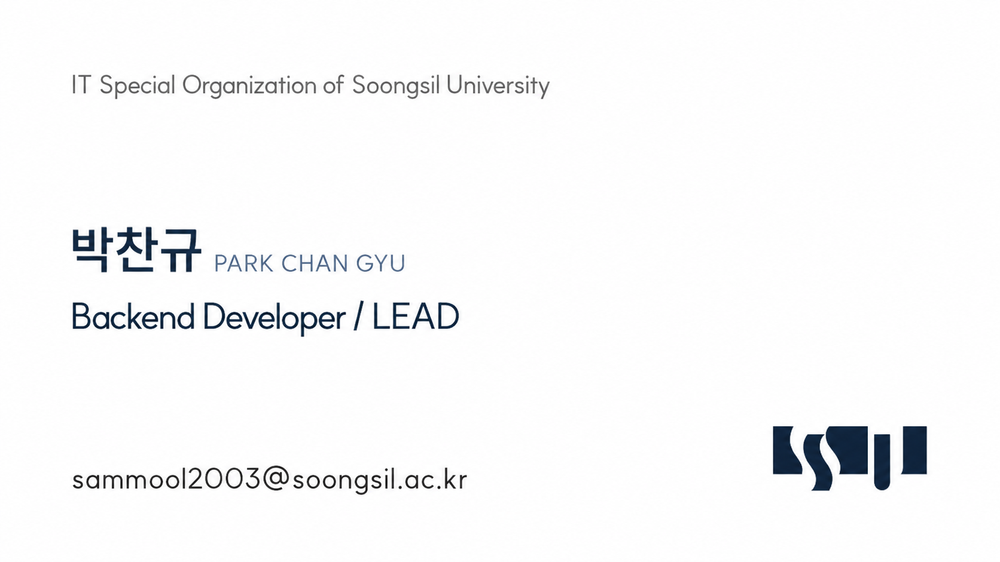

## Park Chan Gyu

Backend & Infrastructure Engineer

I enjoy designing server architectures and building reliable, production-ready systems.  
My primary interests are backend development with Spring Boot and infrastructure engineering with AWS and Terraform.

 

### Experience

- Soongsil University, Computer Science & Engineering  
  Mar 2022 – Present
- IT Special Organization of Soongsil University · Backend Developer  
  Mar 2026 – Present

 

### Tech Stack

**Backend**

**Infrastructure**

### Certifications

- Investment Asset Manager
- SQL Developer (SQLD)

